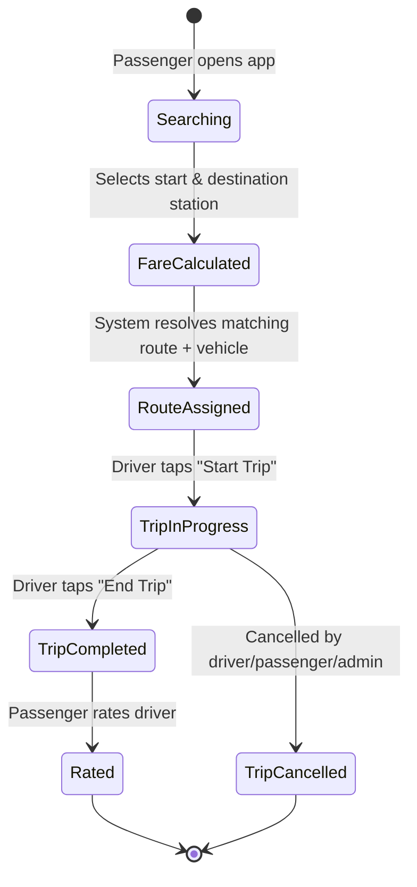

# Business Requirements Document (BRD)

## 1. Purpose

Define the business-level requirements Transportation App must satisfy to be considered a viable replacement/complement for the current informal governorate transport system.

## 2. Business Objectives

| ID | Objective | Measure of Success |
|---|---|---|
| BO-1 | Increase transparency of fares | Zero fare disputes reported through app-booked trips |
| BO-2 | Reduce passenger wait uncertainty | 90% of passengers see accurate ETA within ±2 minutes |
| BO-3 | Enable data-driven route planning | Transport Authority receives monthly analytics reports |
| BO-4 | Reduce operational cost of network changes | Station/route changes require no software release |
| BO-5 | Improve driver accountability | 100% of trips have a digital start/end record |
| BO-6 | Support future growth | Onboarding a new governorate requires configuration only |

## 3. Business Rules

| ID | Rule |
|---|---|
| BR-1 | A station belongs to exactly one governorate. |
| BR-2 | A route belongs to exactly one governorate and consists of an **ordered** sequence of stations. |
| BR-3 | A fare must always be resolvable for any valid (start station, destination station) pair that lies on a common route — otherwise the trip search must clearly report "no route found." |
| BR-4 | Only an Administrator or Transport Authority user may create/edit/delete stations, routes, vehicles, drivers, or fare rules. |
| BR-5 | A Driver may only operate a Trip after being assigned a Vehicle and a Route by an Administrator. |
| BR-6 | Fare rule changes must never retroactively alter the fare of an already-started Trip. |
| BR-7 | Every fare-affecting configuration change must be recorded in `AuditLogs`. |
| BR-8 | A vehicle can be active on only one in-progress trip at a time. |
| BR-9 | Passengers can only rate a driver after a completed trip they were part of. |
| BR-10 | All monetary values are stored in the smallest currency unit (e.g., piastres/cents) as integers to avoid floating-point rounding errors. |

## 4. Business Process — Trip Lifecycle (Overview)

## 5. Constraints

- Must run on Android first (iOS parity required by v1.1).
- Must operate with intermittent connectivity (offline caching of last-known routes/stations).
- Must comply with local data protection regulations for storing passenger location/personal data.
- Budget assumption: Firebase Blaze plan + a small managed PostgreSQL instance (see [Deployment Guide](../08-deployment/DEPLOYMENT_GUIDE.md)).

## 6. Assumptions

- Vehicles are equipped with a driver's smartphone (no dedicated hardware GPS tracker in v1).
- Governorate transport authority provides an initial, verified list of stations and routes for seed data.
- Payment is primarily cash-based in v1; digital payment is a data-modeled but optionally-enabled feature.

## 7. Out of Scope

- Freight/cargo transport.
- Long-distance intercity travel between governorates (v1).
- Integration with national ID verification systems (planned, not v1).

## 8. Approval

| Role | Name | Sign-off |
|---|---|---|
| Product Owner | — | ☐ |
| Transport Authority Representative | — | ☐ |
| Engineering Lead | — | ☐ |
