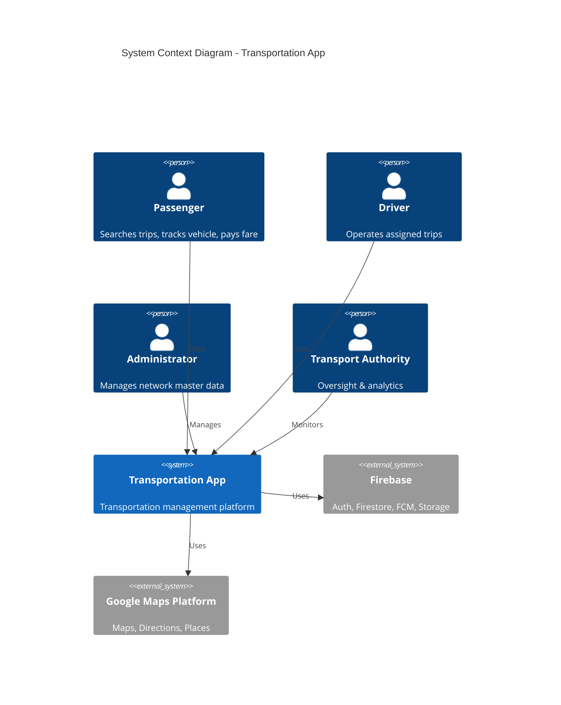

# Software Requirement Specification (SRS)

*Format loosely follows IEEE 830-1998 structure, adapted for an agile delivery team.*

## 1. Introduction

### 1.1 Purpose
This SRS specifies the requirements for Transportation App v1, covering the Passenger App, Driver App, Admin Dashboard, REST API, and supporting Firebase services.

### 1.2 Scope
Transportation App enables dynamic station/route-based trip search, automatic fare calculation, live GPS tracking, and full administrative control of a single governorate's public transport network, built to expand to multiple governorates without re-architecture.

### 1.3 Definitions, Acronyms, Abbreviations

| Term | Meaning |
|---|---|
| Station | A physical, geolocated pick-up/drop-off point |
| Route | An ordered sequence of Stations serviced by one or more Vehicles |
| Trip | A single execution instance of a Route by a Vehicle/Driver, optionally joined by Passengers |
| Fare Rule | A configurable formula/policy used to compute the cost of traveling between two Stations |
| FCM | Firebase Cloud Messaging |
| RBAC | Role-Based Access Control |
| SoT | Source of Truth |

### 1.4 References
- [Business Requirements](../01-overview/BUSINESS_REQUIREMENTS.md)
- [Functional Requirements](../02-requirements/FUNCTIONAL_REQUIREMENTS.md)
- [Database Documentation](../06-database/DATABASE_DOCUMENTATION.md)
- [API Documentation](../07-api/API_DOCUMENTATION.md)

## 2. Overall Description

### 2.1 Product Perspective
Transportation App is specified as a standalone system composed of two Flutter mobile clients (Passenger, Driver), a Flutter Web/React Admin Dashboard, a Node.js REST API, PostgreSQL as relational source of truth, and Firebase for auth/realtime/notifications/storage. These are target-state requirements; see the repository README for currently implemented components.

### 2.2 Product Functions (Summary)
- Dynamic network management (stations/routes/vehicles/drivers/fares).
- Trip search & automatic fare calculation.
- Live GPS tracking & ETA.
- Role-based multi-app experience (Passenger/Driver/Admin/Authority).
- Notifications, ratings, favorites, trip history, analytics/reporting.

### 2.3 User Classes and Characteristics

| User Class | Technical Proficiency | Primary Device |
|---|---|---|
| Passenger | Low–Medium | Android/iOS phone |
| Driver | Low | Android phone (mounted in vehicle) |
| Administrator | Medium–High | Desktop web browser |
| Transport Authority | Medium | Desktop web browser / tablet |

### 2.4 Operating Environment
- Mobile: Android 8.0+ (API 26+), iOS 14+.
- Backend: Docker containers on Linux (Ubuntu 22.04 LTS), Node.js 20 LTS.
- Database: PostgreSQL 15+.
- Cloud: Firebase (Blaze plan), Google Cloud Platform (Maps Platform APIs).

### 2.5 Design and Implementation Constraints
- Flutter + Riverpod + Clean Architecture mandated for all mobile clients.
- No station/route/fare may be hardcoded in application source code (BR/FR-NET-03).
- Must support Arabic RTL and English.
- All monetary values stored as integers in minor currency units.

### 2.6 Assumptions and Dependencies
- Google Maps Platform API keys are provisioned and billed by the governorate/operator.
- Firebase project is provisioned per environment (dev/staging/prod).
- Initial station/route data is supplied by the Transport Authority for seeding.

## 3. System Features (Use Case Summaries)

### 3.1 UC-01: Passenger Searches a Trip and Gets Fare
**Actor:** Passenger
**Preconditions:** Passenger authenticated; stations loaded from API.
**Main Flow:**
1. Passenger opens "Plan Trip" screen.
2. Passenger selects Start Station via searchable dropdown (Places-assisted or DB-backed autocomplete).
3. Passenger selects Destination Station.
4. System calls `POST /api/v1/trips/search` with `start_station_id`, `destination_station_id`.
5. Backend resolves matching Route(s) via `RouteStations` ordering.
6. Backend calculates fare via Fare Engine using the active `FareRule`.
7. Backend returns matched route(s), fare, distance, estimated duration.
8. App renders fare, ETA, and nearby vehicles on the map.

**Alternate Flow:** No common route found → system returns `404` with a descriptive error; app shows "No direct route available."

**Postconditions:** A `Fares` audit record is created for the query (optional, non-billing quote) or a `Trips` record is created once passenger confirms boarding (see UC-02).

### 3.2 UC-02: Driver Starts and Ends a Trip
**Actor:** Driver
**Preconditions:** Driver is assigned a Vehicle and a Route by Admin.
**Main Flow:**
1. Driver opens app, sees today's assigned Route/Vehicle.
2. Driver taps "Start Trip" → `POST /api/v1/trips/{id}/start`.
3. System creates a `Trips` row (status=`in_progress`), begins accepting GPS pings.
4. Driver app pushes GPS every 5–10s → `POST /api/v1/trips/{id}/location` (also mirrored to Firestore `TripLocations`).
5. Driver taps "End Trip" → `POST /api/v1/trips/{id}/end`.
6. System sets status=`completed`, snapshots final `TripHistory`, triggers driver stat aggregation.

### 3.3 UC-03: Administrator Manages a Route
**Actor:** Administrator
**Main Flow:**
1. Admin opens Dashboard → Routes → "New Route."
2. Admin names the route, selects Governorate.
3. Admin adds existing Stations in sequence (drag to reorder → sets `sequence_order`).
4. Admin attaches a Fare Rule (existing or new).
5. Admin saves → `POST /api/v1/routes` + `POST /api/v1/routes/{id}/stations`.
6. Change is immediately available to all Passenger/Driver apps (no release needed).

### 3.4 UC-04: Passenger Rates a Driver
**Actor:** Passenger
**Preconditions:** Trip status = `completed`, passenger was a participant.
**Main Flow:** Passenger submits 1–5 star rating + optional comment → `POST /api/v1/trips/{id}/review` → stored in `Reviews`, aggregated into Driver's average rating.

### 3.5 UC-05: Transport Authority Reviews Analytics
**Actor:** Transport Authority
**Main Flow:** Authority opens Dashboard → Reports → selects date range/route → views trips, revenue, on-time performance, complaint rate charts (`GET /api/v1/reports/*`).

## 4. External Interface Requirements

### 4.1 User Interfaces
See [Flutter Folder Structure](../13-mobile/FLUTTER_FOLDER_STRUCTURE.md) for screen-to-module mapping; wireframe-level detail in [SDD](../04-sdd/SDD.md) §4.

### 4.2 Hardware Interfaces
- Device GPS (driver & passenger location).
- Device camera (profile photo upload via Firebase Storage).

### 4.3 Software Interfaces
- Firebase Authentication, Firestore, FCM, Storage SDKs.
- Google Maps SDK, Directions API, Places API (REST).
- PostgreSQL via REST backend (Node.js/NestJS + TypeORM/Prisma).

### 4.4 Communication Interfaces
- HTTPS/TLS for all REST calls.
- Firestore real-time listeners (WebSocket-based under the hood) for GPS/trip status.
- FCM (HTTPS/XMPP under the hood) for push notifications.

## 5. Other Requirements
See [Non-Functional Requirements](../02-requirements/NON_FUNCTIONAL_REQUIREMENTS.md), [Security Guide](../10-security/SECURITY_GUIDE.md).

## 6. Appendix — Use Case ↔ Functional Requirement Traceability

| Use Case | FR IDs |
|---|---|
| UC-01 | FR-TRIP-01…07, FR-FARE-01…07 |
| UC-02 | FR-DRV-01…04, FR-GPS-01…05 |
| UC-03 | FR-NET-01…08, FR-ADM-01…06 |
| UC-04 | FR-PAX-04 |
| UC-05 | FR-ADM-04 |
