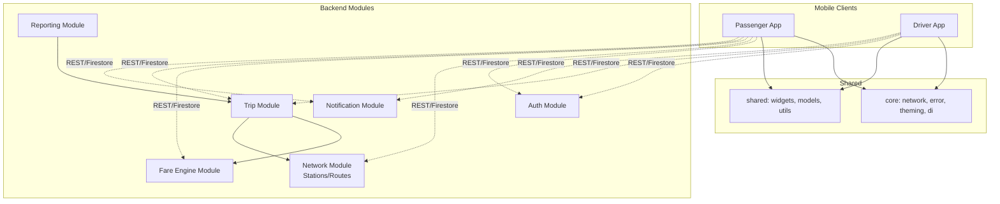
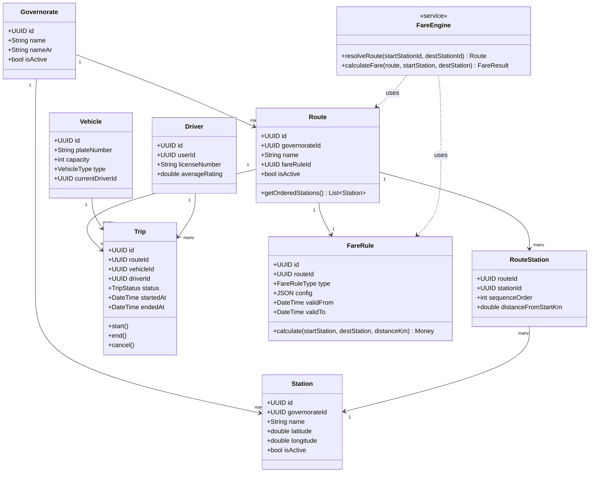
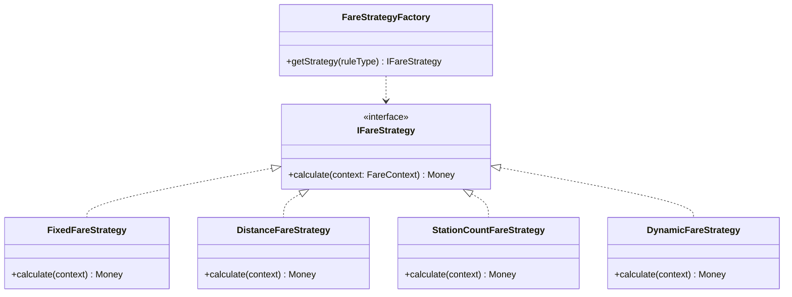
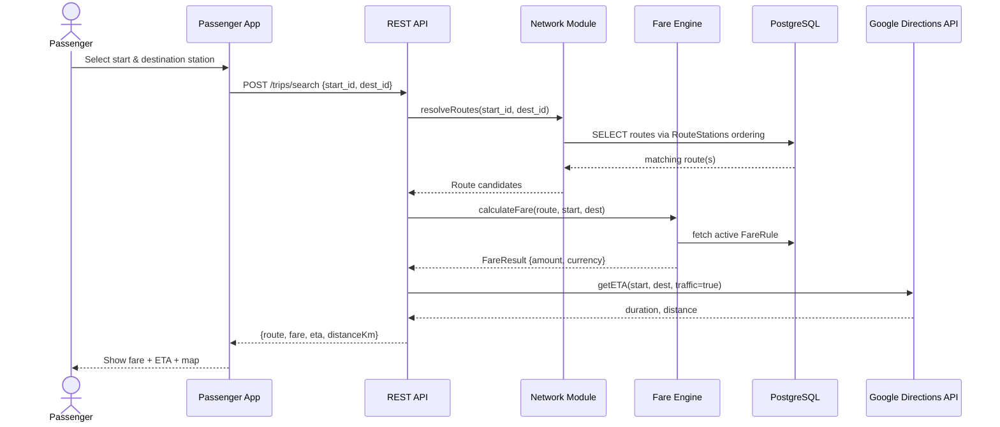
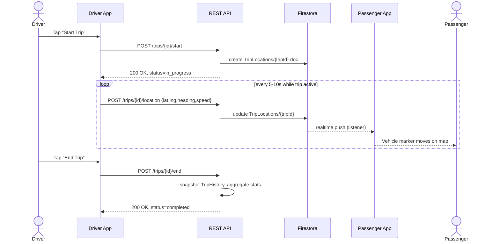
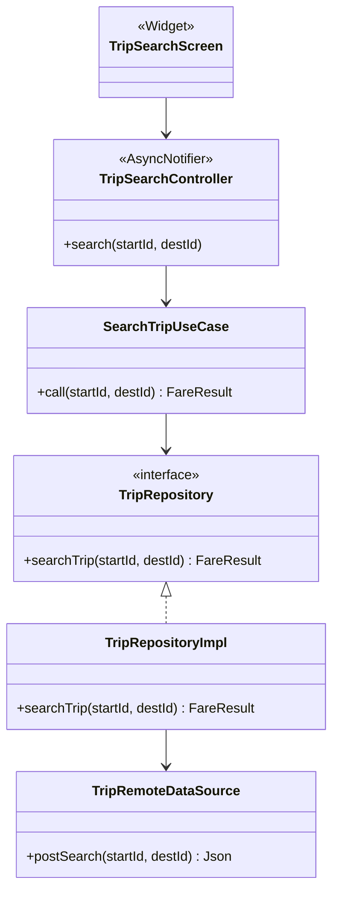

# Software Design Document (SDD)

## 1. Design Goals

1. **Zero hardcoded network data** — every station/route/fare is data-driven.
2. **Clean Architecture** in all Flutter clients — domain layer has no dependency on Flutter, Firebase, or HTTP packages.
3. **Single source of truth per concern** — PostgreSQL for relational/billing data, Firestore for realtime/ephemeral data (live GPS, presence, chat-like notifications).
4. **Extensibility over configuration** — new fare rule types, governorates, and vehicle types added via enums/JSONB config, not schema migrations.

## 2. Module Decomposition



## 3. Class Design (Core Domain)



## 4. Fare Engine — Strategy Pattern

The Fare Engine is designed with the **Strategy Pattern** so new pricing models never require schema or app changes — only a new `rule_type` implementation registered in the backend and a `config` JSONB payload.



**Config examples (`fare_rules.config` JSONB):**

```json
// FIXED
{ "amount_minor": 500 }

// DISTANCE
{ "base_amount_minor": 200, "per_km_minor": 75, "min_fare_minor": 300 }

// STATION_COUNT
{ "per_station_minor": 100, "min_stations_fare_minor": 200 }

// DYNAMIC (v2 — surge)
{ "base_strategy": "DISTANCE", "surge_multiplier_source": "traffic_index", "max_multiplier": 2.0 }
```

## 5. Sequence Diagram — Trip Search & Fare Calculation



## 6. Sequence Diagram — Driver Trip Lifecycle & Live GPS



## 7. Presentation Layer Design (Flutter, Riverpod)

Each feature follows: **UI (Widgets) → Controller/Provider (Riverpod `AsyncNotifier`) → UseCase (domain) → Repository (interface, domain) → RepositoryImpl (data) → RemoteDataSource (REST/Firestore)**.



## 8. Error Handling Design

- Domain layer returns `Either<Failure, T>` (via `fpdart` or `dartz`) — no exceptions cross into the presentation layer.
- API layer returns RFC-7807-style problem responses (`{ "type", "title", "status", "detail", "traceId" }`).
- All Firestore listener errors are caught and mapped to a `ConnectivityFailure` / `PermissionFailure` shown via a shared `ErrorBanner` widget.

## 9. Caching & Offline Strategy

| Data | Cache Strategy |
|---|---|
| Stations/Routes | Cached locally (Hive/SQLite) with `last_synced_at`; refreshed on app start + pull-to-refresh; served from cache if offline |
| Active Fare Rules | Cached with TTL of 1 hour |
| Trip live location | Not cached (realtime only); last known shown greyed-out if disconnected |
| User profile | Cached, synced on login/update |

## 10. Design Decisions & Rationale (ADR summary)

| Decision | Rationale |
|---|---|
| PostgreSQL as relational SoT, Firestore for realtime | Firestore excels at low-latency pub/sub (GPS); PostgreSQL gives strong relational integrity + reporting SQL for billing/analytics |
| Money as integer minor units | Avoids floating-point rounding bugs (NFR-18) |
| Strategy pattern for Fare Engine | Enables new pricing models without redeploying mobile apps |
| Riverpod over Bloc/Provider | Compile-time safety, less boilerplate, first-class async support, easy testing via `ProviderContainer` overrides |
| Clean Architecture | Testability, separation of concerns, framework independence of business logic |
