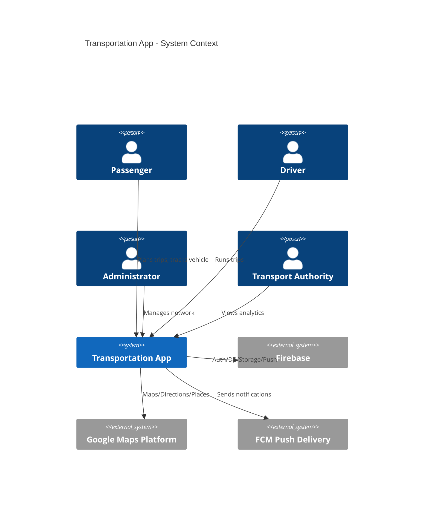
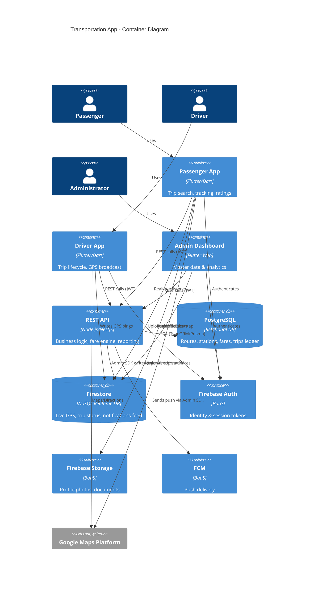
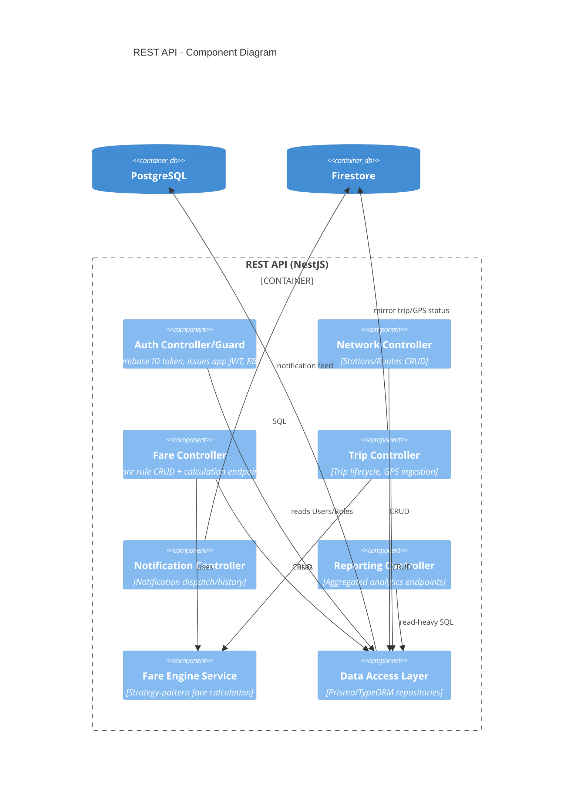
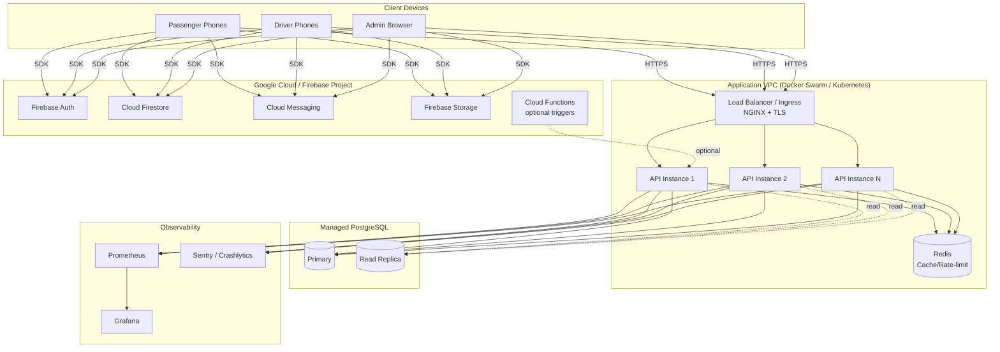
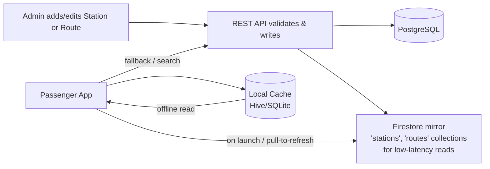

# Architecture Documentation

## 1. Architectural Style

Transportation App is specified to use a **hybrid architecture**:
- **BaaS-first (Firebase)** for auth, realtime sync, push, and storage — minimizes operational overhead for high-churn realtime data (GPS, presence, notifications).
- **Custom REST API (Node.js/NestJS)** backed by **PostgreSQL** as the relational source of truth for master/billing data (routes, fares, trips ledger, reporting) where strong consistency, complex joins, and SQL-based analytics are required.
- **Clean Architecture** on all Flutter clients, isolating domain logic from Flutter/Firebase/HTTP frameworks.

This is a deliberate **polyglot persistence** choice: Firestore is excellent for realtime document sync but weak for relational integrity/reporting; PostgreSQL is the reverse. Each is used for what it's best at.

## 2. C4 Model

### 2.1 Level 1 — System Context

### 2.2 Level 2 — Containers

### 2.3 Level 3 — API Component Diagram

## 3. Deployment Architecture

## 4. Data Flow — "Never Hardcode Stations" Principle

**Key point:** The mobile client code contains **no station/route identifiers or names**. All UI lists (station pickers, route displays) are populated at runtime from Firestore (fast path, cached) or the REST API (authoritative path), backed by the local cache for offline resilience.

## 5. Environments

| Environment | Purpose | Firebase Project | API Host |
|---|---|---|---|
| `dev` | Local/dev testing | `gstms-dev` | `api-dev.transportation-app.local` (docker-compose) |
| `staging` | QA / UAT | `gstms-staging` | `api-staging.transportation-app.example.com` |
| `production` | Live | `gstms-prod` | `api.transportation-app.example.com` |

Flutter **flavors** (`dev`, `staging`, `prod`) select the correct `google-services.json` / `GoogleService-Info.plist`, API base URL, and Maps API key at build time. See [Deployment Guide](../08-deployment/DEPLOYMENT_GUIDE.md).

## 6. Cross-Cutting Concerns

| Concern | Implementation |
|---|---|
| Logging | Structured JSON logs (pino/winston), correlation/trace ID per request |
| Rate limiting | Redis-backed sliding window, per-IP + per-user |
| Caching | Redis for hot reads (active fare rules, route lookups); Firestore mirror for near-real-time station/route reads |
| Config management | `.env` per environment + `Settings` table for runtime-tunable values (no redeploy needed) |
| Feature flags | `Settings` table entries consumed by both API and clients |
