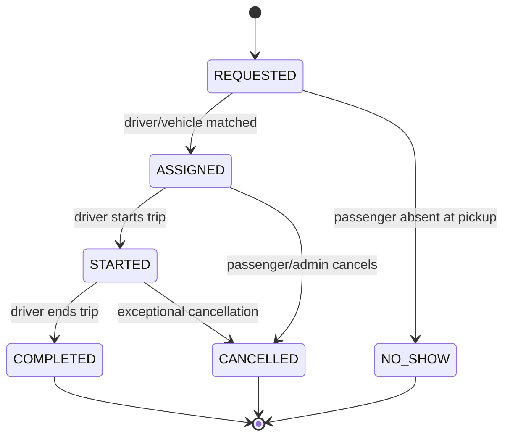

# Database Documentation

## 1. Overview

- **Engine:** PostgreSQL 15+ (with `pgcrypto` for UUID generation, `postgis` for geospatial queries)
- **Full DDL:** [`database/schema.sql`](../../database/schema.sql)
- **ERD:** [ER_DIAGRAM.md](ER_DIAGRAM.md)
- **Naming convention:** `snake_case`, plural table names, singular column names, `id` as UUID PK unless a lightweight enum table (`roles`) uses `SMALLSERIAL`.
- **Monetary storage:** All money columns are `INTEGER` counts of the smallest currency unit (`_cents` suffix) to avoid floating-point rounding errors — e.g., `1910` = 19.10 EGP.

## 2. Table Reference

### 2.1 `governorates`
Top-level scoping entity enabling unlimited future expansion.

| Column | Type | Constraints | Notes |
|---|---|---|---|
| id | UUID | PK | |
| name | VARCHAR(120) | NOT NULL, UNIQUE | English name |
| name_ar | VARCHAR(120) | | Arabic name |
| country_code | CHAR(2) | NOT NULL, default 'EG' | ISO 3166-1 alpha-2 |
| is_active | BOOLEAN | NOT NULL, default TRUE | |
| timezone | VARCHAR(50) | NOT NULL | IANA tz name |

### 2.2 `roles`
Static lookup: `PASSENGER`, `DRIVER`, `ADMIN`, `TRANSPORT_AUTHORITY`.

### 2.3 `users`
Base identity table, one row per authenticated principal (mirrors Firebase Auth `uid`).

| Column | Type | Constraints |
|---|---|---|
| id | UUID | PK |
| firebase_uid | VARCHAR(128) | NOT NULL, UNIQUE |
| full_name | VARCHAR(150) | NOT NULL |
| email | VARCHAR(150) | UNIQUE, nullable |
| phone_number | VARCHAR(20) | UNIQUE, nullable |
| status | user_status enum | default `PENDING_VERIFICATION` |
| governorate_id | UUID | FK → governorates.id |

**Constraint:** `chk_users_contact` — at least one of email/phone must be present.

### 2.4 `user_roles`
M:N join, composite PK `(user_id, role_id)`. A single user can, in principle, be both `ADMIN` and `TRANSPORT_AUTHORITY`.

### 2.5 `passengers` / `drivers`
Table-per-subtype extension of `users` (PK = FK = `user_id`). This avoids a wide, mostly-null `users` table and lets role-specific attributes (license, loyalty points) evolve independently.

### 2.6 `vehicles`
| Column | Notes |
|---|---|
| plate_number | Unique per governorate (`UNIQUE(governorate_id, plate_number)`) — plate formats can repeat across governorates |
| status | `ACTIVE / MAINTENANCE / INACTIVE / RETIRED` — only `ACTIVE` vehicles are eligible for route assignment (enforced in application/service layer, see [API Documentation](../07-api/API_DOCUMENTATION.md)) |
| current_driver_id | Denormalized "who's driving right now" pointer for fast dashboard queries; source of truth for historical driver-vehicle pairing is `vehicle_route_assignments` + `trips` |

### 2.7 `stations`
**The core "no hardcoding" table.** Every station shown in any client dropdown/map is a live row here.

| Column | Notes |
|---|---|
| latitude / longitude | `NUMERIC(9,6)` — ~11cm precision, sufficient for station-level geolocation |
| geog | Generated `geography(Point,4326)` column (STORED) for fast radius/nearest-station queries via GiST index |
| is_active | Soft-delete flag; inactive stations are excluded from passenger-facing search but retained for historical trip integrity |

**Sample "nearest stations" query:**
```sql
SELECT id, name, ST_Distance(geog, ST_MakePoint(:lng, :lat)::geography) AS distance_m
FROM stations
WHERE governorate_id = :governorateId AND is_active = TRUE
ORDER BY geog <-> ST_MakePoint(:lng, :lat)::geography
LIMIT 10;
```

### 2.8 `routes`
| Column | Notes |
|---|---|
| code | Human-friendly identifier (e.g., `R-01`), unique per governorate |
| total_distance_km | Cached aggregate (sum of `route_stations.distance_from_start_km` at last station); recomputed on route-station edit |

### 2.9 `route_stations`
**Stores route order — this is what makes stations "dynamic".**

| Column | Notes |
|---|---|
| station_order | 1-based sequence along the route. `UNIQUE(route_id, station_order)` guarantees no duplicate positions. |
| distance_from_start_km | Cumulative distance from the route's first station — used directly by the distance-based fare strategy (delta between two stations' values = trip distance) without needing a live Directions API call for pricing. |

**Sample query — get ordered stations for a route (what the app calls to populate pickers):**
```sql
SELECT s.id, s.name, s.latitude, s.longitude, rs.station_order, rs.distance_from_start_km
FROM route_stations rs
JOIN stations s ON s.id = rs.station_id
WHERE rs.route_id = :routeId
ORDER BY rs.station_order;
```

### 2.10 `vehicle_route_assignments`
Tracks which vehicle(s) operate which route(s) over time (`is_current` flags the active assignment; historical rows retained for reporting/audit).

### 2.11 `fare_rules`
**The Fare Engine's configuration table** — see [SDD §4 Fare Engine](../04-sdd/SDD.md) for full calculation logic.

| Column | Notes |
|---|---|
| fare_type | `FIXED / DISTANCE_BASED / STATION_BASED / DYNAMIC` |
| is_active | Only one active rule per route at a time — enforced by partial unique index `uq_one_active_fare_per_route` |
| drafted_by / approved_by | Supports the two-step Admin-drafts → Authority-approves workflow (BR-07) |
| effective_from / effective_to | Supports scheduled fare changes (e.g., holiday pricing) |

### 2.12 `trips`
The central transactional entity — one row per passenger journey.

| Column | Notes |
|---|---|
| fare_rule_id | **Immutably references the fare rule active at request time** — even if the rule is later edited/deactivated, this FK preserves exactly which pricing was applied (BR-06) |
| status | State machine: `REQUESTED → ASSIGNED → STARTED → COMPLETED` (or `CANCELLED` / `NO_SHOW` at various points) |

**Trip status state machine:**


### 2.13 `trip_locations`
High-frequency GPS breadcrumb table (one row per ~5s per active trip). See §7 for partitioning strategy.

### 2.14 `trip_history`
**Intentionally denormalized** immutable snapshot written once a trip reaches a terminal state. Preserves route/station *names* as text so historical records remain readable even if a station is later renamed or deactivated.

### 2.15 `fares`
Line-item breakdown of a computed fare (base/distance/station/surcharge components) — supports the "fare breakdown" UI (FR-025) and is separate from `fare_rules` (which is *configuration*, not a *computed instance*).

### 2.16 `tickets`
One issued ticket per trip with a human/QR-scannable `ticket_code`.

### 2.17 `payments`
Supports `CASH` today; `CARD/WALLET/MOBILE_MONEY` enums pre-declared for [Future Features](../12-roadmap/FUTURE_FEATURES.md) without a schema migration.

### 2.18 `notifications`
Generic notification log; `data JSONB` carries deep-link payloads (e.g., `{"tripId": "...", "screen": "trip_tracking"}`).

### 2.19 `reviews`
1:1 with `trips` (`UNIQUE` on `trip_id`) — one review per completed trip.

### 2.20 `favorites`
Passenger-favorited stations; `UNIQUE(user_id, station_id)` prevents duplicates.

### 2.21 `settings`
Generic governorate-scoped (or global, `governorate_id IS NULL`) key/value config store (e.g., GPS broadcast interval, cancellation window) — lets Ops tune behavior without deployments.

### 2.22 `audit_logs`
Append-only log of every configuration mutation (`CREATE/UPDATE/DELETE/PUBLISH/APPROVE`) with `before_state`/`after_state` JSONB snapshots for full traceability (FR-064, BR-06).

## 3. Normalization Analysis

| Table | Normal Form Achieved | Justification |
|---|---|---|
| users / passengers / drivers | 3NF | Table-per-subtype avoids nullable role-specific columns on a shared table |
| route_stations | 3NF | Composite relationship attributes (`station_order`, `distance_from_start_km`) depend only on the (route,station) pair, not on any other table |
| fare_rules / fares | 3NF | Config (`fare_rules`) vs. computed instance (`fares`) kept separate to avoid update anomalies when a rule changes after a trip is quoted |
| trip_history | Deliberate denormalization | Snapshots avoid retroactive changes to historical records if `routes`/`stations` are edited/renamed later — documented exception, not an oversight |

## 4. Indexing Strategy

| Table | Index | Purpose |
|---|---|---|
| stations | `idx_stations_geog` (GiST) | Nearest-station / radius search |
| stations | `idx_stations_governorate`, `idx_stations_active` | Fast dynamic dropdown population filtered by governorate + active flag |
| route_stations | `idx_route_stations_route` (route_id, station_order) | Ordered station list retrieval in one index scan |
| fare_rules | `uq_one_active_fare_per_route` (partial unique) | Enforces business rule at the DB layer, not just app layer |
| trips | `idx_trips_status`, `idx_trips_passenger`, `idx_trips_driver` | Dashboard/live-ops filtering |
| trip_locations | `idx_trip_locations_trip_time` (trip_id, recorded_at) | Efficient breadcrumb retrieval for a given trip in chronological order |
| audit_logs | `idx_audit_logs_entity`, `idx_audit_logs_actor` | Fast "who changed X" investigations |

## 5. Referential Integrity & Delete Strategy

| Relationship | On Delete | Rationale |
|---|---|---|
| `trips.passenger_id` → users | RESTRICT | Never silently orphan financial/trip records |
| `route_stations.route_id` → routes | CASCADE | Deleting a route removes its station sequence (routes are typically deactivated, not hard-deleted, via `is_active`) |
| `route_stations.station_id` → stations | RESTRICT | Prevent deleting a station still referenced by a route; must be removed from routes first |
| `trip_locations.trip_id` → trips | CASCADE | Breadcrumbs have no independent lifecycle |
| `trip_history.trip_id` → trips | RESTRICT | Historical record must never disappear silently |

## 6. Sample Data
See the seed section at the bottom of [`schema.sql`](../../database/schema.sql) — includes one governorate, 4 stations, 1 route with ordered stations, 1 active fare rule, 1 vehicle, 3 users (passenger/driver/admin), and one full completed trip lifecycle (trip → fare → ticket → payment → history → review).

## 7. Partitioning & Scaling Strategy

- **`trip_locations`**: partition by `RANGE (recorded_at)` monthly once volume exceeds ~50M rows/month. Older partitions (90+ days) get aggregated into `trip_history` distance/duration summaries and then archived/dropped per the data retention policy (NFR-070).
- **`audit_logs`**: partition by `RANGE (created_at)` yearly; archive to cold storage after 3 years (regulatory retention permitting).
- **`trips`/`payments`**: no partitioning needed until >10M rows/governorate; add `RANGE (requested_at)` partitioning at that scale.
- **Read replicas**: Admin/Authority reporting queries and `v_daily_revenue`-style views are directed to a Postgres read replica to isolate analytical load from the transactional write path.

## 8. Backup & Recovery
See [Maintenance Guide](../11-maintenance/MAINTENANCE_GUIDE.md) §3 (Backup & Recovery).
