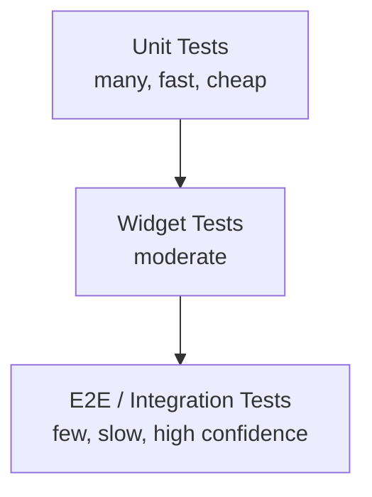

# Testing Guide

## 1. Testing Strategy Overview



Target coverage: **≥ 70%** on domain/use-case layers, **≥ 60%** overall, enforced in CI (build fails below threshold).

## 2. Unit Testing (Flutter — domain & data layers)

Framework: `flutter_test` + `mocktail` (or `mockito`) for mocking repositories/data sources.

```dart
// test/features/trip/domain/usecases/search_trip_usecase_test.dart
void main() {
  late MockTripRepository repository;
  late SearchTripUseCase useCase;

  setUp(() {
    repository = MockTripRepository();
    useCase = SearchTripUseCase(repository);
  });

  test('returns FareResult when repository call succeeds', () async {
    final expected = FareResult(amountMinor: 1910, currency: 'EGP', etaSeconds: 1200);
    when(() => repository.searchTrip(any(), any()))
        .thenAnswer((_) async => Right(expected));

    final result = await useCase(startId: 's1', destId: 's2');

    expect(result, Right(expected));
    verify(() => repository.searchTrip('s1', 's2')).called(1);
  });

  test('returns Failure when no route connects stations', () async {
    when(() => repository.searchTrip(any(), any()))
        .thenAnswer((_) async => const Left(NoRouteFoundFailure()));

    final result = await useCase(startId: 's1', destId: 's9');

    expect(result, const Left(NoRouteFoundFailure()));
  });
}
```

**Fare Engine unit tests (backend, Jest):**

```javascript
describe('DistanceFareStrategy', () => {
  it('computes base + distance component', () => {
    const strategy = new DistanceFareStrategy();
    const result = strategy.calculate({
      config: { base_amount_minor: 200, per_km_minor: 75, min_fare_minor: 300 },
      distanceKm: 9.4,
    });
    expect(result.amountMinor).toBe(200 + Math.round(9.4 * 75));
  });

  it('enforces minimum fare floor', () => {
    const strategy = new DistanceFareStrategy();
    const result = strategy.calculate({
      config: { base_amount_minor: 50, per_km_minor: 10, min_fare_minor: 300 },
      distanceKm: 0.5,
    });
    expect(result.amountMinor).toBe(300);
  });
});
```

## 3. Widget Testing (Flutter)

```dart
testWidgets('TripSearchScreen shows fare after selecting stations', (tester) async {
  await tester.pumpWidget(
    ProviderScope(
      overrides: [
        tripSearchControllerProvider.overrideWith(() => FakeTripSearchController()),
      ],
      child: const MaterialApp(home: TripSearchScreen()),
    ),
  );

  await tester.tap(find.byKey(const Key('start_station_dropdown')));
  await tester.pumpAndSettle();
  await tester.tap(find.text('Central Station'));
  await tester.pumpAndSettle();

  await tester.tap(find.byKey(const Key('dest_station_dropdown')));
  await tester.pumpAndSettle();
  await tester.tap(find.text('Industrial Zone'));
  await tester.pumpAndSettle();

  expect(find.textContaining('19.10 EGP'), findsOneWidget);
});
```

Key widget test targets: station picker autocomplete, fare display, map marker rendering (via a fake `GoogleMapController`), trip status banner, rating dialog.

## 4. Integration Testing

Using `integration_test` package + a real (or emulated) backend:

- **Passenger flow:** login → search trip → view fare/ETA → (mock) board trip → view live tracking → rate driver.
- **Driver flow:** login → view assigned route → start trip → simulate GPS pings → end trip → view stats.
- **Admin flow (web):** login → create station → create route → attach stations in order → create+approve fare rule → verify it's immediately queryable via API.

Run against Firebase Emulator Suite for auth/Firestore, and a Dockerized Postgres/API for the backend, to keep integration tests hermetic and CI-friendly:

```bash
firebase emulators:start --only auth,firestore &
docker compose -f backend/docker-compose.test.yml up -d
flutter test integration_test/ -d chrome
```

## 5. API Testing

Tooling: **Jest + Supertest** (backend) and/or **Postman/Newman** collections for contract-level regression, run in CI against a fresh seeded database.

```javascript
describe('POST /trips/search', () => {
  it('returns fare and ETA for a valid station pair', async () => {
    const res = await request(app)
      .post('/api/v1/trips/search')
      .set('Authorization', `Bearer ${testToken}`)
      .send({ startStationId: seed.stationCentral, destStationId: seed.stationIndustrial });

    expect(res.status).toBe(200);
    expect(res.body.totalCents).toBeGreaterThan(0);
    expect(res.body.routeId).toBe(seed.routeR01);
  });

  it('returns 422 when start equals destination', async () => {
    const res = await request(app)
      .post('/api/v1/trips/search')
      .set('Authorization', `Bearer ${testToken}`)
      .send({ startStationId: seed.stationCentral, destStationId: seed.stationCentral });

    expect(res.status).toBe(422);
    expect(res.body.error.code).toBe('INVALID_STATION_PAIR');
  });

  it('returns 404 when no route connects the two stations', async () => {
    const res = await request(app)
      .post('/api/v1/trips/search')
      .set('Authorization', `Bearer ${testToken}`)
      .send({ startStationId: seed.stationCentral, destStationId: seed.unrelatedStation });

    expect(res.status).toBe(404);
  });
});
```

Contract tests should also validate the OpenAPI spec (`api/openapi.yaml`) against actual responses using a schema-validation middleware in test mode.

## 6. Performance Testing

Tooling: **k6** or **Artillery** for HTTP load, custom scripts for Firestore write throughput.

```javascript
// k6 script: fare-calculation-load.js
import http from 'k6/http';
import { check, sleep } from 'k6';

export const options = {
  stages: [
    { duration: '1m', target: 100 },
    { duration: '3m', target: 500 },
    { duration: '1m', target: 0 },
  ],
  thresholds: {
    http_req_duration: ['p(95)<300', 'p(99)<800'], // NFR-01
  },
};

export default function () {
  const res = http.post('https://api-staging.transportation-app.example.com/api/v1/trips/search', JSON.stringify({
    startStationId: 'STATION_A', destStationId: 'STATION_B',
  }), { headers: { 'Content-Type': 'application/json', Authorization: `Bearer ${__ENV.TOKEN}` } });
  check(res, { 'status is 200': (r) => r.status === 200 });
  sleep(1);
}
```

GPS ingestion load test simulates 300 concurrent vehicles each posting a location every 7 seconds, verifying end-to-end propagation to a Firestore listener stays under 5 seconds (NFR-03).

## 7. Security Testing

- **SAST:** ESLint security plugin + `npm audit` / `dart pub outdated --mode=null-safety` in CI.
- **DAST:** OWASP ZAP baseline scan against staging on every release candidate.
- **Manual pentest checklist:** auth bypass attempts, IDOR on `/trips/{id}` (verify a passenger cannot fetch another passenger's trip), Firestore rules fuzzing (attempt writes as unauthenticated/wrong-role client), rate-limit verification (429 after threshold), JWT tampering/expiry tests.
- **Dependency scanning:** Dependabot / Snyk enabled on the repository.

See [Security Guide](../10-security/SECURITY_GUIDE.md) for the full threat model.

## 8. Test Data & Environments

| Environment | Data Source |
|---|---|
| Unit tests | In-memory fakes/mocks, no network |
| Widget tests | `ProviderScope` overrides with fake controllers |
| Integration tests | Firebase Emulator Suite + Dockerized Postgres, seeded via `schema.sql` |
| API/perf tests | Staging environment, dedicated test governorate/dataset (never production data) |

## 9. CI Gate Summary

| Gate | Tool | Failing Condition |
|---|---|---|
| Lint | `flutter analyze`, `eslint` | Any error-level lint violation |
| Format | `dart format`, `prettier --check` | Unformatted files |
| Unit + Widget tests | `flutter test --coverage` | Any failure, or coverage < 70% domain |
| Backend tests | `npm test -- --coverage` | Any failure, or coverage < 70% |
| Build | `flutter build appbundle`, `docker build` | Build failure |
| Security scan | `npm audit`, ZAP baseline (staging only) | High/critical vulnerability found |
