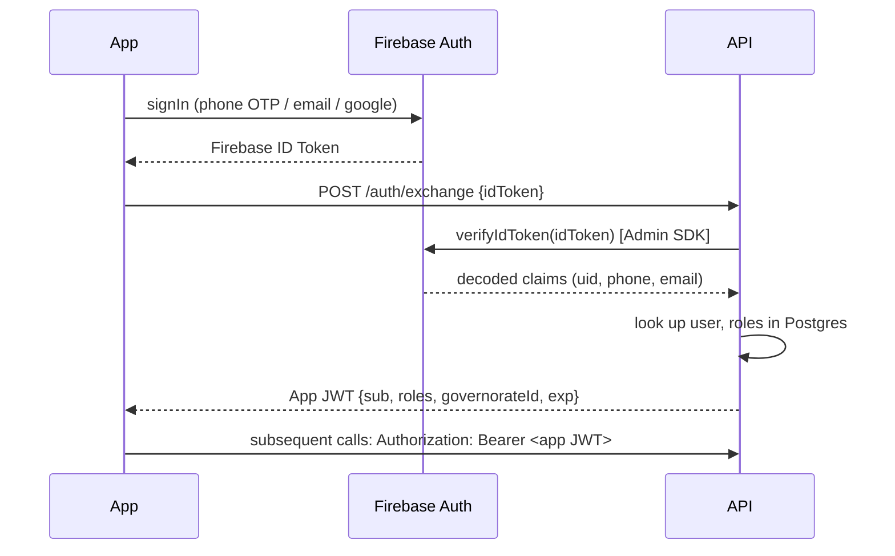

# Security Guide

## 1. Threat Model Summary

| Asset | Threats | Mitigations |
|---|---|---|
| Passenger/Driver PII (name, phone, location) | Unauthorized access, data scraping | RBAC, Firestore rules, TLS, minimal data retention |
| Fare/Trip financial data | Tampering, fraud (fake trips/fares) | Server-authoritative fare calculation, audit logs, immutable `trip_history` |
| Live GPS stream | Spoofing, stalking via leaked location | Rules scoped to trip participants only, ephemeral storage, driver consent |
| Admin Dashboard | Privilege escalation, unauthorized network changes | RBAC + MFA for Admin/Authority accounts, full audit trail |
| API | DDoS, brute force, injection | Rate limiting, parameterized queries/ORM, WAF, input validation |

## 2. Authentication

- **Firebase Authentication** issues ID tokens (JWT, RS256, Google-managed keys) after phone OTP / email-password / Google sign-in.
- The backend verifies the Firebase ID token on every request via the **Firebase Admin SDK** (`verifyIdToken`), then issues its own short-lived **application JWT** (HS256/RS256, 15–60 min expiry) carrying `userId`, `roles`, `governorateId` claims for fast authorization checks without re-hitting Firebase on every call.
- Refresh: client silently refreshes the Firebase ID token via the client SDK and exchanges it for a new app JWT as needed.



## 3. Authorization — Role-Based Access Control (RBAC)

Roles: `PASSENGER`, `DRIVER`, `ADMIN`, `TRANSPORT_AUTHORITY` (see [Database Documentation](../06-database/DATABASE_DOCUMENTATION.md) `user_roles`).

Enforcement layers:
1. **API Gateway Guard** — every controller route declares required role(s) via a decorator (e.g., `@Roles('ADMIN','TRANSPORT_AUTHORITY')`); a global guard rejects with `403` otherwise.
2. **Row-level checks** — e.g., `PATCH /trips/{id}/start` additionally verifies `trips.driver_id === currentUser.driverId`, not just role membership.
3. **Firestore Security Rules** — mirror the same role model for direct client reads/writes (below).

Full endpoint matrix in [API Documentation §15](../07-api/API_DOCUMENTATION.md).

## 4. Firestore Security Rules

```javascript
rules_version = '2';
service cloud.firestore {
  match /databases/{database}/documents {

    function isSignedIn() { return request.auth != null; }
    function role() { return request.auth.token.role; }
    function isOwner(userId) { return isSignedIn() && request.auth.uid == userId; }

    // Stations & routes: public read (dynamic network), writes only via backend (Admin SDK bypasses rules)
    match /stations/{stationId} {
      allow read: if true;
      allow write: if false; // all writes go through the REST API using the Admin SDK
    }
    match /routes/{routeId} {
      allow read: if true;
      allow write: if false;
    }

    // Live trip status/location: readable by trip participants only
    match /trip_locations/{tripId} {
      allow read: if isSignedIn() &&
        (resource.data.driverUserId == request.auth.uid ||
         resource.data.passengerUserIds.hasAny([request.auth.uid]) ||
         role() in ['ADMIN', 'TRANSPORT_AUTHORITY']);
      allow write: if false; // written only by backend (Admin SDK) after driver's REST POST
    }

    // Notifications: user can only read/mark-read their own
    match /notifications/{notifId} {
      allow read, update: if isOwner(resource.data.userId);
      allow create: if false; // backend-only
    }

    // Everything else denied by default
    match /{document=**} {
      allow read, write: if false;
    }
  }
}
```

**Design rationale:** Nearly all writes are funneled through the REST API using the Firebase **Admin SDK**, which bypasses security rules entirely. This means Firestore rules exist primarily to lock down **unauthorized client reads/writes**, not to implement business logic — business logic and validation live in the API layer, where it can be properly tested (see [Testing Guide](../09-testing/TESTING_GUIDE.md)).

## 5. Transport Security

- **HTTPS/TLS 1.2+** enforced everywhere (API load balancer terminates TLS; HTTP requests redirected to HTTPS).
- **HSTS** header enabled on all API responses.
- Google Maps/Directions/Places API keys are **restricted**: Android key restricted by package name + SHA-1, iOS key restricted by bundle ID, server-side key restricted by IP and API (Directions/Places only, no Maps JS).

## 6. Data Encryption

| Data | At Rest | In Transit |
|---|---|---|
| PostgreSQL | Managed provider disk encryption (AES-256) + optional column-level encryption for `national_id` | TLS to DB (`sslmode=require`) |
| Firestore | Google-managed encryption at rest | TLS (SDK default) |
| Firebase Storage (photos/docs) | Google-managed encryption at rest | TLS |
| Secrets (.env, service account keys) | Stored in a secrets manager (GCP Secret Manager / Vault), never committed to git | N/A |
| Mobile local cache (Hive/SQLite) | Encrypted box (`hive` + `flutter_secure_storage` key) for any cached PII | N/A (device-local) |

## 7. Secure Storage on Mobile

- Session tokens (Firebase refresh token, app JWT) stored via `flutter_secure_storage` (Keychain on iOS, EncryptedSharedPreferences/Keystore on Android) — **never** in plain `SharedPreferences`.
- No sensitive data logged in release builds (log level gated by build flavor).

## 8. Input Validation

- All API request bodies validated against DTO schemas (`class-validator` in NestJS / `zod` schemas) before touching business logic.
- Geo-coordinates bounded (`-90..90`, `-180..180`).
- Station/route names sanitized against injection in free-text fields (parameterized queries via ORM — no raw string concatenation, ever).
- File uploads (profile photos) validated by MIME type + max size (5MB) + re-encoded server-side (or via Firebase Storage rules) to strip malicious metadata.

## 9. Rate Limiting

- Redis-backed sliding-window limiter: `100 req/min` per authenticated user on general endpoints, `10 req/min` on `POST /trips/{id}/location` per driver (well above the 7–10s ping interval, but bounded), `5 req/min` on `POST /auth/*` endpoints to blunt brute force.
- `429 Too Many Requests` with `Retry-After` header on breach.

## 10. Auditability

Every mutation to `stations`, `routes`, `route_stations`, `fare_rules`, `vehicles`, `drivers` writes an `audit_logs` row with `before_state`/`after_state` JSONB (BR-7). Audit logs are **append-only** — no `UPDATE`/`DELETE` permission granted to the application's database role on `audit_logs`.

## 11. Compliance & Data Retention

- GPS breadcrumb data (`trip_locations`) retained 90 days in hot storage, then aggregated/archived (see [Database Documentation §7](../06-database/DATABASE_DOCUMENTATION.md)).
- Users may request account deletion; PII is anonymized in historical trip records (`trip_history` retains ride statistics for reporting but not identity) while financial records are retained per local tax/audit regulations.
- A documented Data Processing Agreement should be established with the Transport Authority as data controller/processor if required by local law.

## 12. Security Incident Response

1. **Detect** — alerting on anomalous auth failure rates, unusual admin actions (via `audit_logs` + Grafana alerting).
2. **Contain** — revoke compromised tokens/API keys, force password/OTP re-verification for affected accounts.
3. **Eradicate** — patch the vulnerability, rotate secrets.
4. **Recover** — restore from backup if data integrity affected (see [Maintenance Guide](../11-maintenance/MAINTENANCE_GUIDE.md)).
5. **Review** — postmortem, update this guide and relevant tests.
